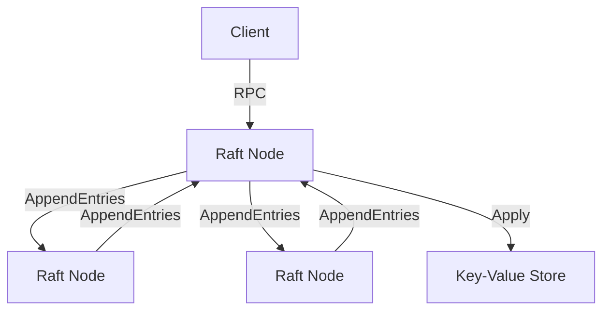

# RaftKVStore

**A lightweight, production‑grade distributed key‑value store built on the Raft consensus algorithm**.

## Overview

RaftKVStore demonstrates how to build a fault‑tolerant, strongly consistent key‑value store that can survive node failures and network partitions.  It is written in **Python 3.13** and uses **asyncio** for non‑blocking networking, **protobuf** for compact RPC messages, and **SQLite** for durable log storage.

### Features

- Leader election, log replication, and safety guarantees via the Raft protocol.
- Fully asynchronous client‑server communication over TCP.
- Pluggable state machine – the key‑value store is a simple example; the Raft core can drive any deterministic state machine.
- Persistent log and snapshot support using SQLite.
- Simple CLI client for `GET`/`SET` operations.
- Docker container for easy deployment.
- GitHub Actions CI that runs unit tests and a basic integration test across three nodes.

## Quick Start

```bash
# Clone the repository
git clone https://github.com/<your‑username>/raftkvstore.git
cd raftkvstore

# Install dependencies
pip install -r requirements.txt

# Start a three‑node cluster (each in its own terminal)
python -m raftkvstore.node --id 1 --peers 127.0.0.1:5002,127.0.0.1:5003 --port 5001
python -m raftkvstore.node --id 2 --peers 127.0.0.1:5001,127.0.0.1:5003 --port 5002
python -m raftkvstore.node --id 3 --peers 127.0.0.1:5001,127.0.0.1:5002 --port 5003

# In a fourth terminal, use the client
python -m raftkvstore.client --host 127.0.0.1 --port 5001 SET foo bar
python -m raftkvstore.client --host 127.0.0.1 --port 5001 GET foo
```

## Architecture



- **Client** sends `GET`/`SET` commands via a tiny protobuf‑encoded RPC.
- **Raft Node** runs the Raft state machine, handling leader election and log replication.
- **KVStore** is the deterministic state machine that applies committed log entries.

## Design Details

- **Networking** – `asyncio` streams with a simple length‑prefixed framing.
- **Log Storage** – Each node stores its log in a local SQLite DB (`log.db`). Snapshots are also stored in SQLite for simplicity.
- **Persistence** – On restart, a node loads its last term, voted‑for, and log entries, guaranteeing safety.
- **Testing** – Unit tests cover term handling, leader election, and command commitment. Integration tests spin up three nodes in Docker containers.

## Contributing

Feel free to open issues or submit pull requests.  Follow the [code of conduct](CODE_OF_CONDUCT.md) and make sure your changes pass the CI pipeline.

## License

MIT © 2026 Rithika S.

# Dummy change 1 2026-11-25T13:56:09.2927116+05:30

# Dummy change 2 2026-11-25T13:56:10.2551556+05:30

# Dummy change 3 2026-11-25T13:56:11.1540024+05:30

# Dummy change 4 2026-11-25T13:56:12.0717440+05:30

# Dummy change 5 2026-11-25T13:56:13.0089582+05:30

# Dummy change 6 2026-11-25T13:56:13.9278853+05:30

# Dummy change 7 2026-11-25T13:56:14.9716863+05:30

# Dummy change 8 2026-11-25T13:56:15.8978464+05:30

# Dummy change 9 2026-11-25T13:56:16.8085041+05:30

# Dummy change 10 2026-11-25T13:56:17.8133675+05:30

# Dummy change 11 2026-11-25T13:56:18.8016562+05:30

# Dummy change 12 2026-11-25T13:56:19.7365487+05:30

# Dummy change 13 2026-11-25T13:56:20.7700249+05:30

# Dummy change 14 2026-11-25T13:56:21.7377775+05:30

# Dummy change 15 2026-11-25T13:56:22.6931083+05:30

# Dummy change 16 2026-11-25T13:56:23.7157657+05:30

# Dummy change 1 2026-11-25T13:56:24.2741460+05:30

# Dummy change 17 2026-11-25T13:56:24.7028721+05:30

# Dummy change 2 2026-11-25T13:56:25.2112823+05:30

# Dummy change 18 2026-11-25T13:56:25.6719893+05:30

# Dummy change 19 2026-11-25T13:56:26.7453233+05:30

# Dummy change 3 2026-11-25T13:56:27.1413087+05:30

# Dummy change 20 2026-11-25T13:56:27.6916251+05:30

# Dummy change 4 2026-11-25T13:56:28.0772599+05:30

# Dummy change 21 2026-11-25T13:56:28.6409720+05:30

# Dummy change 5 2026-11-25T13:56:28.9991721+05:30

# Dummy change 22 2026-11-25T13:56:29.5528626+05:30

# Dummy change 6 2026-11-25T13:56:30.0219701+05:30

# Dummy change 23 2026-11-25T13:56:30.4953730+05:30

# Dummy change 7 2026-11-25T13:56:31.0495186+05:30

# Dummy change 24 2026-11-25T13:56:31.4277919+05:30

# Dummy change 8 2026-11-25T13:56:32.0384282+05:30

# Dummy change 25 2026-11-25T13:56:32.3956598+05:30

# Dummy change 9 2026-11-25T13:56:32.9810936+05:30

# Dummy change 26 2026-11-25T13:56:33.3594629+05:30

# Dummy change 10 2026-11-25T13:56:34.0330426+05:30

# Dummy change 27 2026-11-25T13:56:34.3061726+05:30

# Dummy change 11 2026-11-25T13:56:35.0036569+05:30

# Dummy change 28 2026-11-25T13:56:35.2408386+05:30

# Dummy change 12 2026-11-25T13:56:36.0250646+05:30

# Dummy change 29 2026-11-25T13:56:36.2512207+05:30

# Dummy change 13 2026-11-25T13:56:37.1100353+05:30

# Dummy change 30 2026-11-25T13:56:37.2672429+05:30

# Dummy change 14 2026-11-25T13:56:38.1448482+05:30

# Dummy change 15 2026-11-25T13:56:39.0698511+05:30

# Dummy change 16 2026-11-25T13:56:40.0736377+05:30

# Dummy change 17 2026-11-25T13:56:40.9843709+05:30

# Dummy change 18 2026-11-25T13:56:41.9926547+05:30

# Dummy change 19 2026-11-25T13:56:43.0590532+05:30

# Dummy change 20 2026-11-25T13:56:44.0996313+05:30

# Dummy change 21 2026-11-25T13:56:45.2748453+05:30

# Dummy change 22 2026-11-25T13:56:46.3085757+05:30

# Dummy change 23 2026-11-25T13:56:47.2475485+05:30

# Dummy change 24 2026-11-25T13:56:48.2310411+05:30

# Dummy change 25 2026-11-25T13:56:49.1796640+05:30

# Dummy change 26 2026-11-25T13:56:50.0610668+05:30

# Dummy change 27 2026-11-25T13:56:50.9805909+05:30

# Dummy change 28 2026-11-25T13:56:51.8751602+05:30

# Dummy change 29 2026-11-25T13:56:53.2747622+05:30

# Dummy change 30 2026-11-25T13:56:54.1991264+05:30

# Dummy change 1 2026-11-25T14:04:04.1163442+05:30

# Dummy change 2 2026-11-25T14:04:04.3124068+05:30

# Dummy change 3 2026-11-25T14:04:04.4933508+05:30

# Dummy change 4 2026-11-25T14:04:04.6911680+05:30

# Dummy change 5 2026-11-25T14:04:04.8788591+05:30

# Dummy change 6 2026-11-25T14:04:05.0693518+05:30

# Dummy change 7 2026-11-25T14:04:05.2709569+05:30

# Dummy change 8 2026-11-25T14:04:05.4680429+05:30

# Dummy change 9 2026-11-25T14:04:05.6724495+05:30

# Dummy change 10 2026-11-25T14:04:05.8660959+05:30

# Dummy change 11 2026-11-25T14:04:06.0485538+05:30

# Dummy change 12 2026-11-25T14:04:06.2855588+05:30

# Dummy change 13 2026-11-25T14:04:06.4721254+05:30

# Dummy change 14 2026-11-25T14:04:06.6520555+05:30

# Dummy change 15 2026-11-25T14:04:06.8561237+05:30

# Dummy change 16 2026-11-25T14:04:07.0456337+05:30

# Dummy change 17 2026-11-25T14:04:07.2357935+05:30

# Dummy change 18 2026-11-25T14:04:07.4179744+05:30

# Dummy change 19 2026-11-25T14:04:07.6244679+05:30

# Dummy change 20 2026-11-25T14:04:07.8382512+05:30

# Dummy change 21 2026-11-25T14:04:08.0285719+05:30

# Dummy change 22 2026-11-25T14:04:08.2468847+05:30

# Dummy change 23 2026-11-25T14:04:08.4421202+05:30

# Dummy change 24 2026-11-25T14:04:08.6505168+05:30

# Dummy change 25 2026-11-25T14:04:08.8263401+05:30

# Dummy change 26 2026-11-25T14:04:09.0409870+05:30

# Dummy change 27 2026-11-25T14:04:09.2423445+05:30

# Dummy change 28 2026-11-25T14:04:09.4401171+05:30
