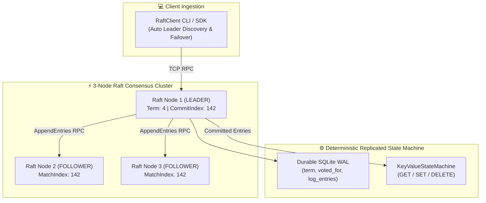

# RaftKVStore

<p align="center">
  
  
  
  
  
  
</p>

---

## ⚡ Overview

**RaftKVStore** is an institutional-grade, fault-tolerant distributed replicated state machine and key-value storage engine engineered on the **Raft Consensus Algorithm** (Ongaro & Ousterhout). Built with non-blocking `asyncio` streams and durable SQLite WAL persistence, RaftKVStore guarantees **strict linearizable consistency**, automatic leader election with randomized jitter timeouts, and cluster safety across network partitions and hardware failures.

---

## 🏗️ Architecture



---

## 🚀 Key Architectural Features

- **Formal Leader Election:** Randomized election timeouts (150ms–300ms) prevent split-vote deadlocks; candidates request votes and transition to leader upon receiving majority quorum.
- **Log Matching & Replication:** Heartbeat-driven `AppendEntries` RPC verifies log continuity (`prev_log_index` / `prev_log_term`) and forces followers to replicate leader logs.
- **Durable Write-Ahead Logging:** State transitions (`current_term`, `voted_for`, and log sequence) persist durably to SQLite with ACID transaction semantics.
- **Deterministic State Machine:** Key-value engine executes committed log entries strictly in sequence, guaranteeing zero state divergence across surviving nodes.
- **Network Partition Tolerance:** Minority partitions cannot commit new log entries; majority partitions continue serving reads and writes without interruption.

---

## 💻 Quickstart

### Prerequisites
- Python 3.10+
- `pytest` & `pytest-asyncio`

### 1. Installation
```bash
git clone https://github.com/Rithikasri-code/raftkvstore.git
cd raftkvstore
pip install -r requirements.txt
```

### 2. Run Test Suite
```bash
pytest tests/ -v
```

### 3. Spin Up a 3-Node Cluster
```bash
# Terminal 1 (Node 1)
python -m raftkvstore.server --id node_1 --port 5001 --peers 127.0.0.1:5002,127.0.0.1:5003

# Terminal 2 (Node 2)
python -m raftkvstore.server --id node_2 --port 5002 --peers 127.0.0.1:5001,127.0.0.1:5003

# Terminal 3 (Node 3)
python -m raftkvstore.server --id node_3 --port 5003 --peers 127.0.0.1:5001,127.0.0.1:5002
```

### 4. Execute Client Queries
```bash
# Write a key
python -m raftkvstore.client SET alpha "production_cluster"

# Read the key
python -m raftkvstore.client GET alpha
```

---

## 📄 License

Distributed under the **MIT License**.
